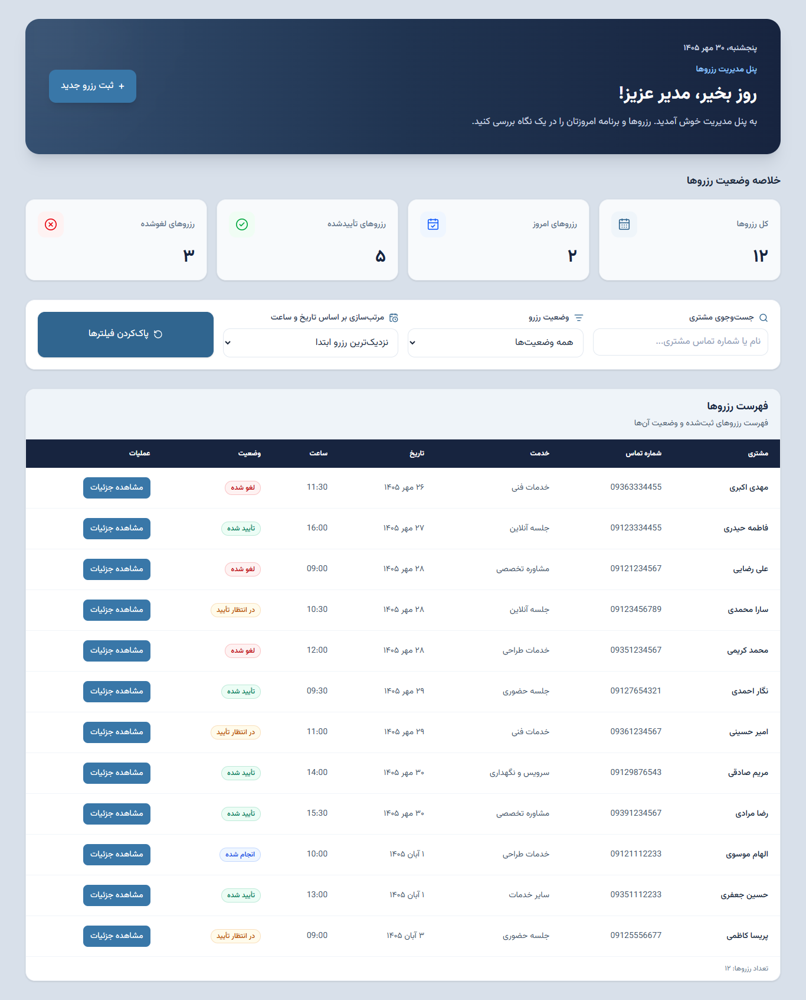
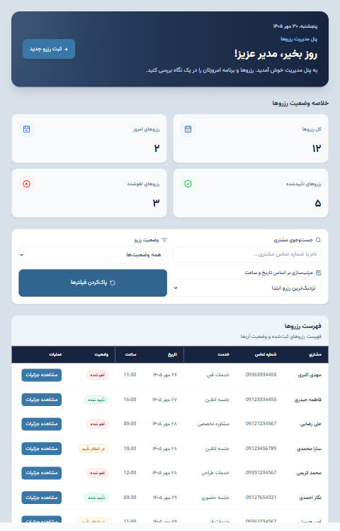
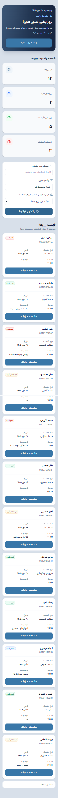
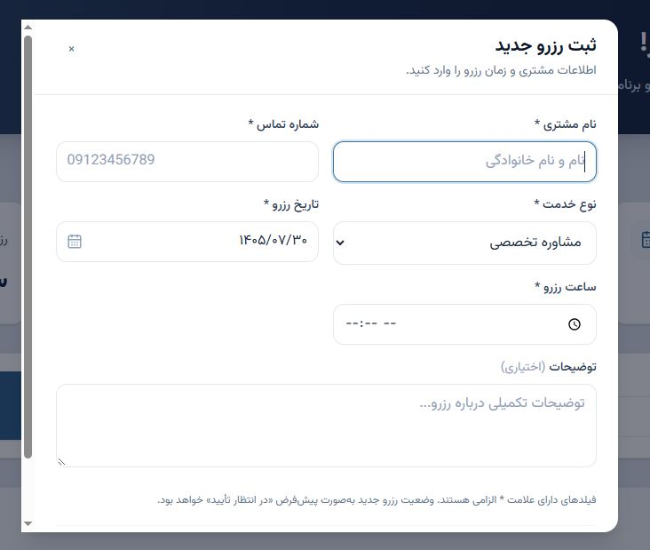
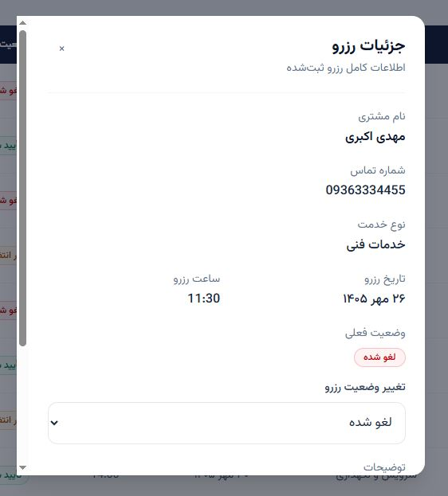

# داشبورد مدیریت رزروها

یک داشبورد واکنش‌گرا برای مدیریت رزروها که با React، TypeScript و Vite ساخته شده است. این برنامه رابطی برای مدیریت رزروها، پیگیری وضعیت آن‌ها و مشاهده آمار رزروها فراهم می‌کند.

## ویژگی‌ها

- **نمای کلی داشبورد:** مشاهده آمار رزروها و خلاصه وضعیت‌های اصلی.
- **مدیریت رزروها:** ثبت رزروها همراه با اعتبارسنجی فرم.
- **جزئیات رزرو:** مشاهده اطلاعات رزرو در یک پنجره اختصاصی.
- **مدیریت وضعیت:** به‌روزرسانی وضعیت رزروها، شامل در انتظار، تأییدشده، تکمیل‌شده و لغوشده.
- **جستجو و فیلتر:** یافتن رزروها و فیلتر کردن نتایج نمایش‌داده‌شده.
- **مرتب‌سازی:** سازمان‌دهی رزروها با استفاده از گزینه‌های مرتب‌سازی موجود.
- **ذخیره‌سازی پایدار:** ذخیره اطلاعات رزروها در حافظه محلی مرورگر.
- **طراحی واکنش‌گرا:** سازگار کردن رابط کاربری با صفحه‌نمایش‌های دسکتاپ و موبایل.
- **اعلان‌های Toast:** نمایش بازخورد برای عملیات موفق و خطاها.
- **دسترسی‌پذیری با صفحه‌کلید:** استفاده از کلید `Tab` برای جابه‌جایی بین عناصر قابل فوکوس، کلید `Escape` برای بستن پنجره رزرو و کلید `+` برای باز کردن فرم ثبت رزرو جدید. هنگام بسته شدن پنجره رزرو با کلید `Escape` یا پس از ثبت موفق رزرو، فوکوس به دکمه **ثبت رزرو جدید** بازمی‌گردد.
- **چیدمان راست‌به‌چپ:** ارائه رابطی سازگار با زبان فارسی و چیدمان RTL.

## فناوری‌های استفاده‌شده

- React
- TypeScript
- Vite
- Tailwind CSS
- Lucide React
- حافظه محلی مرورگر (Local Storage)

## شروع کار

### پیش‌نیازها

- Node.js
- npm

### نصب

۱. مخزن را کلون کنید:

```bash
git clone https://github.com/nasrinsoufi/reservation-management-dashboard.git
```

۲. وارد پوشه پروژه شوید:

```bash
cd reservation-management-dashboard
```

۳. وابستگی‌ها را نصب کنید:

```bash
npm install
```

### اجرای سرور توسعه

```bash
npm run dev
```

### ساخت نسخه Production

```bash
npm run build
```

### پیش‌نمایش نسخه Production

```bash
npm run preview
```

### اجرای ESLint

```bash
npm run lint
```

## مستندات فنی

برای مشاهده جزئیات پیاده‌سازی و تصمیم‌های فنی اصلی، به [تصمیم‌های فنی](docs/TECHNICAL_DECISIONS.md) مراجعه کنید.

## ذخیره‌سازی داده‌ها

اطلاعات رزروها در حافظه محلی مرورگر ذخیره می‌شوند. این برنامه در حال حاضر از ذخیره‌سازی سمت کاربر استفاده می‌کند و به سرور بک‌اند یا پایگاه داده نیاز ندارد.


## تصاویر پروژه

### داشبورد دسکتاپ



### داشبورد تبلت



### داشبورد موبایل



### فرم ثبت رزرو



### جزئیات رزرو



